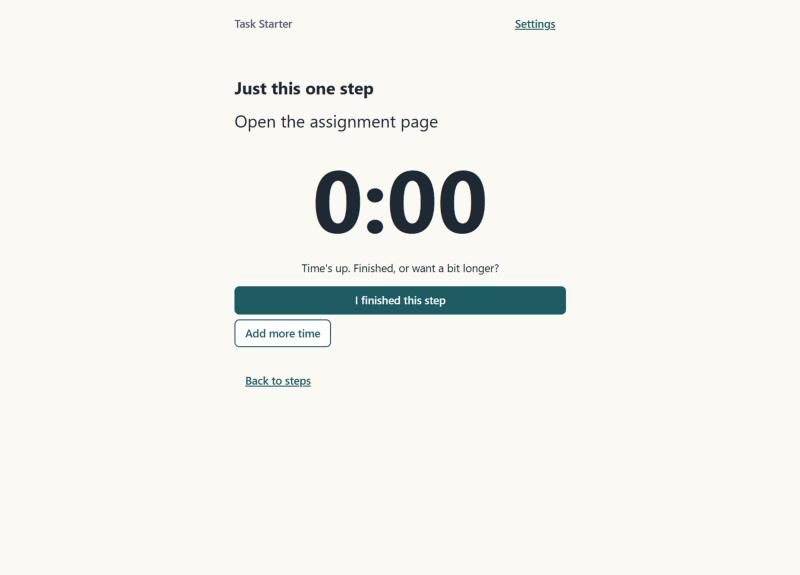

# Unit 4 Mini-Project: Task Starter

> DRAFT written by Claude from the project rules and the finished app.
> Jacob: rewrite this in your own words, check every claim against the
> app, and then export it to a single PDF. Delete this box when done.

## Purpose (half a page)

**The constraint.** A student with ADHD who has trouble starting tasks
sits down to begin a writing assignment that is due tomorrow. They open
the laptop and freeze. "Write the essay" is one huge item with no visible
first move, and each minute of not starting adds guilt, which makes
starting even harder.

**The tool.** Task Starter is one small web tool with one job: getting
that student from frozen to working on a first step. It does this in a
single short flow:

1. Type the one task you are avoiding.
2. Break it into small steps.
3. Start one step with a large countdown timer (10 minutes by default).
4. See a gentle "step done" message and the next step.

It is deliberately not a to-do app. It holds one task at a time, shows one
main button per screen, and has no accounts, due dates, points or streaks.

## The moment a majority design would choose differently

**When the timer reaches zero.** A timer built for the typical user treats
zero as the end: the session is over, and an unfinished item is shown as
missed or overdue, often in red. For most people that is a helpful nudge.

For this student it is the exact thing that causes the freeze. Being
marked as behind is what makes the task feel impossible to go back to.

Task Starter makes the opposite call. At zero it shows "Time's up.
Finished, or want a bit longer?" and offers three ways forward: "I finished
this step", "Add more time", or "Back to steps". Nothing is marked failed,
skipped or late, and going back leaves the step exactly as it was. The
"no shame states" rule was in the project rules before any screen was
built, so this was not added afterwards.

## Rationale (half a page)

**The constraint and where an ordinary product breaks.** Difficulty
starting tasks is a common part of ADHD. An ordinary to-do or timer app
breaks for this student at two points: first when it shows the whole task
as one item with nothing small enough to begin, and again when it reports
an unfinished item as a failure. The second point is the one marked above.

**How the design addresses it.**

- The app asks for small steps before anything else, so there is always a
  first move that looks doable.
- The timer screen shows only the current step, so the size of the whole
  task is out of sight while working.
- Ten minutes is the default, because a short, fixed commitment is easier
  to begin than an open-ended one.
- When time runs out, the user decides what it means. The app never
  decides that they failed.
- Feedback is gentle (a check mark, a kind sentence, "3 of 5 steps done")
  and every part of it can be switched off.

**Curb-cut benefit.** The same choice helps anyone who is exhausted,
anxious or overwhelmed, not only people with ADHD: a new parent with ten
free minutes, someone returning to work after being ill, or any student
procrastinating before a deadline. A tool that shows one small step and
never tells you that you failed is easier for everyone to pick back up.

## Before submitting

- [ ] Rewrite the text above in your own words.
- [ ] Confirm the constraint is the one you want. It was chosen by Claude
      as a suggestion.
- [ ] The brief says "this is not a multi-screen app". This tool has four
      short screens. Ask your instructor if that is acceptable, or present
      only the timer and step-done screens as the designed feature.
- [ ] Export to one PDF and submit with the project and the AI Log.
